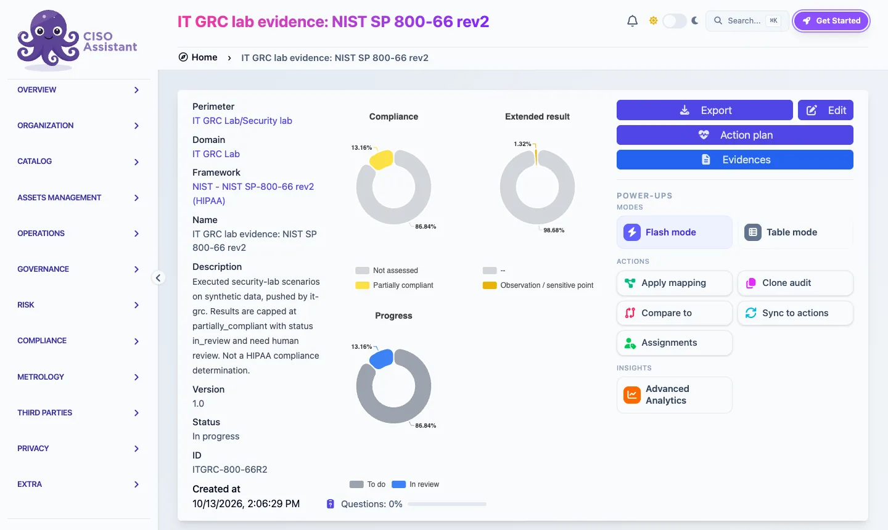
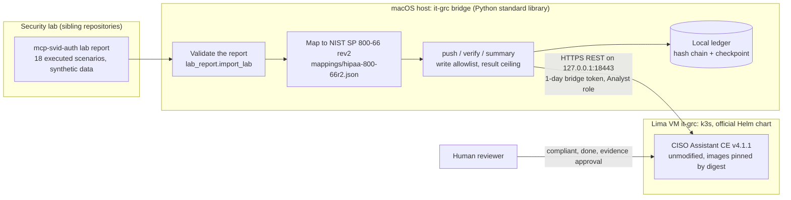
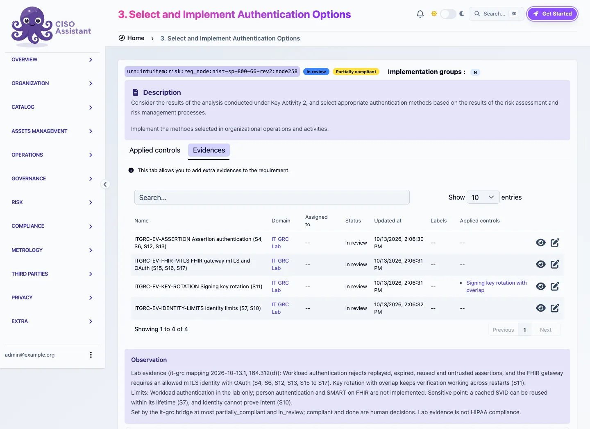
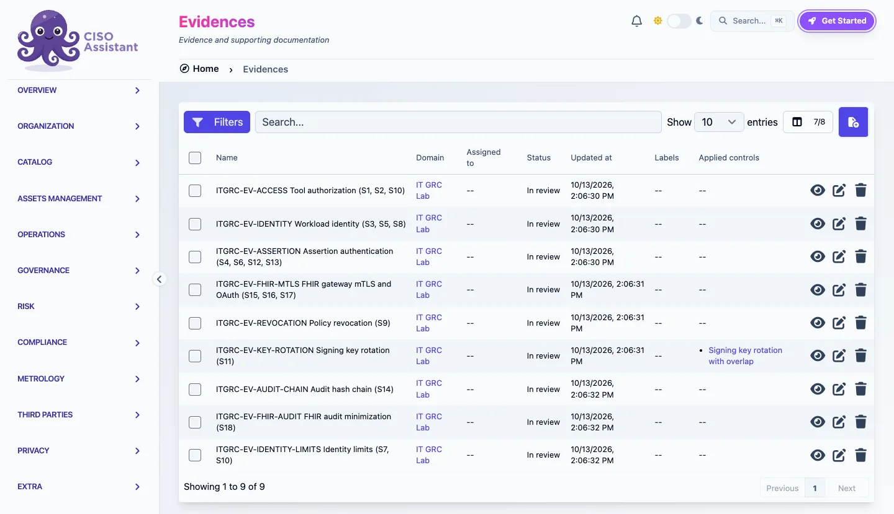
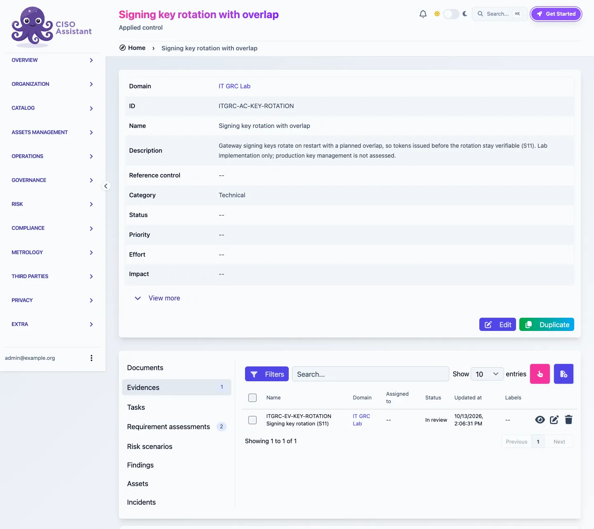

# IT GRC

[](https://github.com/tanya-ok/it-grc/actions/workflows/ci.yml)

IT GRC pushes executed security-lab evidence into [CISO Assistant Community edition](https://github.com/intuitem/ciso-assistant-community) (CE), used as the GRC system of record, and verifies it later. CE runs unmodified from its upstream images in a dedicated local VM; IT GRC talks to it only over its REST API. The 18 scenarios of the security lab become evidence revisions, one applied control and capped requirement results against the public NIST SP 800-66 rev2 (HIPAA) framework. The bridge sets at most `partially_compliant` with status `in_review`; `compliant`, `done` and evidence approval stay human decisions in CE.

Documentation: https://tanya-ok.github.io/it-grc/



## Why a real GRC system of record

The prototype (version 0.1.1, local tag `v0.1.1-prototype`) built its own control catalog, findings model, review states, report export and web UI. A system of record needs framework libraries, audits, evidence revisions, applied controls, roles and an audit trail, and a maintained public framework is easier to trust than a homemade catalog. CE provides all of that. The part worth building is the bridge: executed scenarios with capture time, producer revisions and digests, mapped to public requirements with explicit limits. [ADR 0001](docs/adr/0001-ciso-assistant-system-of-record.md) records the decision.

## Architecture



- The bridge validates the report, builds a deterministic plan from the versioned mapping, then ensures the audit `ITGRC-800-66R2`, one evidence object per scenario group, evidence revisions, the applied control and the mapped requirement assessments. Every object is found by a stable key first, so a second run changes nothing.
- Every lookup that targets one object asserts exactly one match, and requirement lookups also assert the exact URN and an assessable node, because CE silently ignores unknown query filters.
- Every push appends a record to a local hash-chained ledger. `it-grc verify` compares CE with the latest record and reports drift; rows that a human has taken over are listed as `HELD`.

## Quickstart

Requires macOS with Lima 2.2.1 or newer (`vz`), Python 3.12 or newer and `make`. Docker Desktop and Podman are not used. Runtime dependencies: Python standard library only.

```sh
make check          # offline tests and repository checks
make grc-up         # dedicated it-grc VM, k3s, chart 0.13.3, pins re-verified first
make grc-admin      # first time: administrator from a generated password in deploy/.data
make grc-bootstrap  # library, domain, perimeter, bridge user and 1-day token; idempotent
make grc-demo       # dry run, push, verify, ledger verify and summary
make grc-stop       # stop the VM; CISO Assistant stays installed
```

Open https://localhost:18443 and trust `deploy/.data/ca.pem`. Secrets stay in owner-only files under the git-ignored `deploy/.data/`; no command prints them.

## Demo

`make grc-demo` pushes the retained lab report `fixtures/lab/demo-report-2026-10-13.json`, or a fresh one with `make grc-demo REPORT=../mcp-svid-auth/deploy/.data/demo-report.json`. On 2026-10-13 against CE v4.1.1 the audit held 20 `partially_compliant` and 132 `not_assessed` of 152 assessable requirements, evidence coverage of 13.2 percent, 9 evidence objects in review and none approved, and verify found no drift. The [demo walkthrough](docs/demo.md) covers start, bootstrap, push, verify, the UI and stop.

| Requirement assessment | Evidence list |
|---|---|
|  |  |
| **Applied control** | |
|  | |

## Commands

| Make target | Command | Effect |
|---|---|---|
| `grc-up`, `grc-status`, `grc-verify`, `grc-stop`, `grc-down`, `grc-destroy` | `scripts/grc_lab.py` | VM and CE lifecycle; see [Deployment](docs/deployment.md) |
| `grc-admin`, `grc-admin-secret`, `grc-rotate-admin` | `grc_lab.py`, `it-grc rotate-admin` | Administrator login and password rotation |
| `grc-bootstrap`, `grc-token-refresh`, `grc-bridge-check` | `it-grc bootstrap`, `token-refresh`, `bridge-check` | Bridge domain, user and 1-day token; see [Bridge](docs/bridge.md) |
| `grc-push-dry-run`, `grc-push` | `it-grc push --report <path> [--dry-run]` | Planned or applied changes and a ledger record; see [Mapping](docs/mapping.md) |
| `grc-push-verify` | `it-grc verify` | Compare CE with the latest ledger record; exit 1 on drift |
| `grc-ledger-verify` | `it-grc ledger verify` | Offline check of the ledger chain and checkpoint |
| `grc-summary` | `it-grc summary` | Read only: result and status counts, coverage, evidence status |
| `grc-demo` | the five commands above | End-to-end run on an already bootstrapped instance |

## What the evidence proves, and what it does not

| The evidence shows | It does not show |
|---|---|
| The 18 named lab scenarios ran on 2026-10-13 with the recorded outcomes, on synthetic data in a local Lima and k3s lab | HIPAA compliance, or that any organization meets the HIPAA Security Rule |
| Workload identity, token, mutual TLS and audit-chain behavior of the lab components, as partial evidence for 20 requirement nodes | That those 20 key activities are met in full; person authentication, workforce, physical, administrative and organizational safeguards are not covered, and 97 requirements stay `not_verified` |
| The stored attachment hash of every evidence revision equals the SHA-256 the bridge computed | That the lab is still in that state; a saved report is dated evidence, not a live check |
| What the bridge wrote and when, in a local hash-chained ledger that `verify` reconciles with CE | Protection against someone who controls the host: the ledger is unsigned and sits beside its checkpoint |

## Claims discipline

- The bridge sets at most `partially_compliant` with status `in_review`. `compliant`, `not_applicable`, `done`, locking and evidence approval are human decisions in CE; a write allowlist refuses them before any request is sent.
- Missing evidence stays `not_verified` with result `not_assessed`. Only a failed basis scenario sets `non_compliant`, a proven lab failure.
- Every observation carries the mapping version, the CFR reference, the rationale and the limits.
- NIST SP 800-66 rev2 is guidance for implementing the HIPAA Security Rule, not the rule itself.
- The mapping is one engineer's reading of the framework against a lab. Review each row before relying on it.
- A lab report is untrusted input. Only validated fields reach CE; free text from the report is never uploaded.

## License boundary

- IT GRC is licensed under the [Apache License, Version 2.0](LICENSE). Redistributions must keep the [NOTICE](NOTICE) file.
- CISO Assistant CE is AGPL-3.0-or-later. IT GRC runs it unmodified from upstream images pinned by digest and exchanges data with it over HTTPS only. Modifying CE would bring AGPL source-offer duties; this project avoids that.
- No CE source code, serializers, API schemas or library YAML are copied into this repository. Frameworks are loaded into CE by URN, and the mapping contract check reads the pinned library into memory only.
- IT GRC is not affiliated with or endorsed by intuitem. The screenshots show CE's own UI with synthetic data.

## Development

```sh
uv sync --locked
uv run make check
uv run ruff check
uv run ruff format --check
uv run mypy
make mapping-contract   # needs network: the pinned upstream library, read into memory
uvx --from zensical==0.0.65 zensical build --strict
```

`make check` runs the lab-report validator tests, the bridge and ledger tests against an in-memory CE stand-in on loopback HTTPS, the lifecycle script tests, the mapping contract tests on synthetic library files and the repository hygiene check. CI runs the same checks on Python 3.12 to 3.14, plus gitleaks; see [Continuous integration](docs/publication-readiness.md#continuous-integration).

## Documentation

- [Overview](docs/index.md), [demo](docs/demo.md) and [article](docs/article.md)
- [Deployment of CE in the it-grc VM](docs/deployment.md)
- [Bridge client, bootstrap, ledger and verification](docs/bridge.md)
- [Mapping and push to NIST SP 800-66 rev2](docs/mapping.md)
- [ADR 0001: CISO Assistant as the system of record](docs/adr/0001-ciso-assistant-system-of-record.md)
- [Security model](docs/security.md), [independent provenance](docs/provenance.md) and [lab report digests](docs/evidence-digests.md)
- [Roadmap](docs/roadmap.md) and [publication readiness](docs/publication-readiness.md)
- [Security policy](SECURITY.md), [contributing](CONTRIBUTING.md) and [changelog](CHANGELOG.md)

## Task tracking

Use local beads for follow-up work: `bd --sandbox ready`, then update task status and validation evidence. The reviewable snapshot is `.beads/issues.jsonl`; exclude personal tasks and owner fields when exporting. Remote synchronization is disabled.

## License

Copyright 2026 Tanya Babitskaya. Licensed under the [Apache License, Version 2.0](LICENSE). Redistributions must keep the [NOTICE](NOTICE) file. Third-party components keep their own terms.
