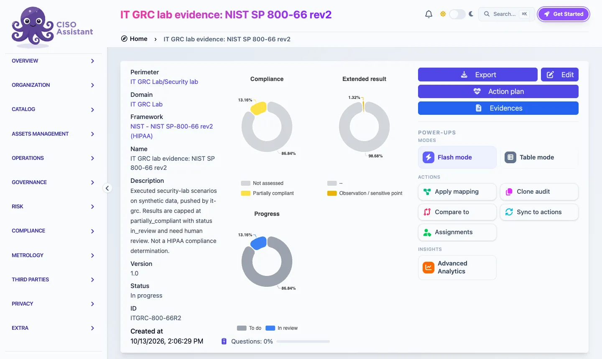
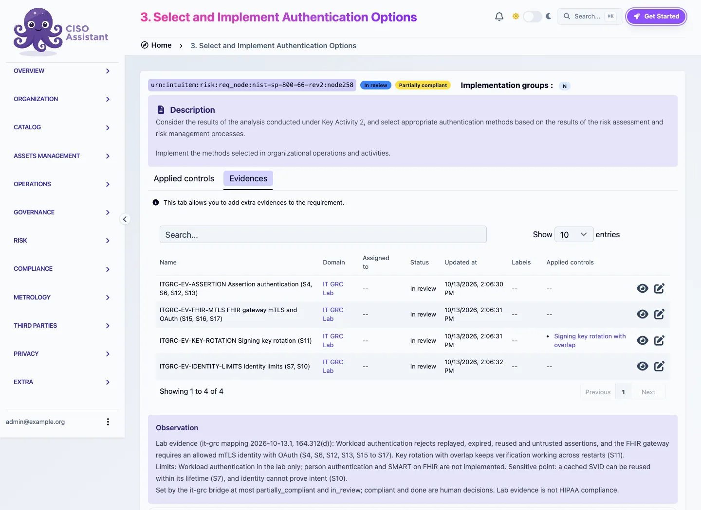
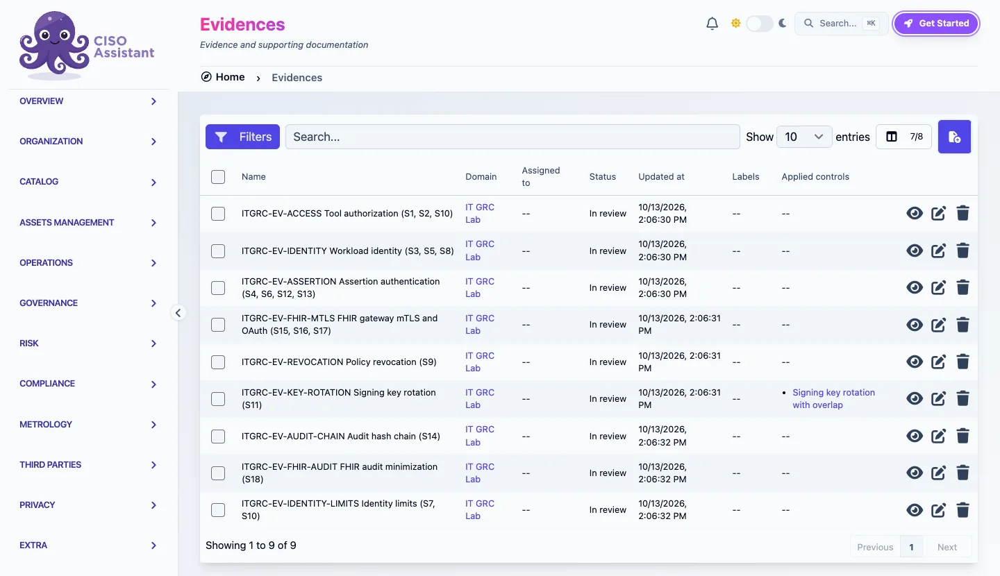
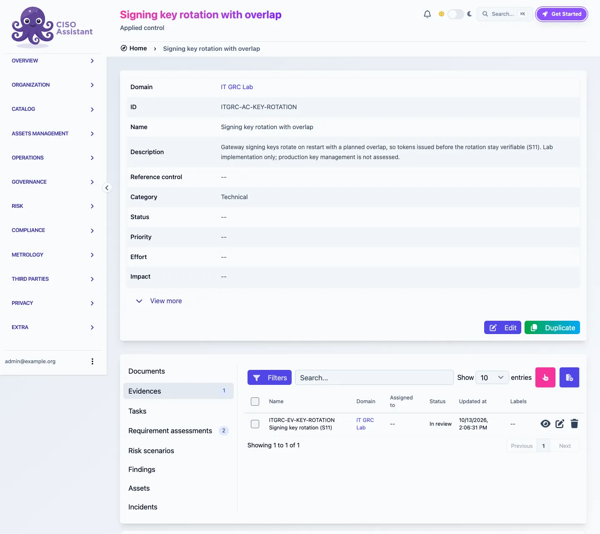

# Demo

This walkthrough pushes the executed security-lab report into CISO Assistant Community edition in the local `it-grc` VM, verifies the result and shows where to look in the CISO Assistant UI. Every command runs from the repository root. No command prints a password or token; secrets stay in owner-only files under the git-ignored `deploy/.data/`.

!!! warning "What the demo shows"
    Executed lab scenarios on synthetic data, mapped to NIST SP 800-66 rev2 and capped at `partially_compliant` with status `in_review`. This is not HIPAA compliance. `compliant` and `done` stay human decisions in CISO Assistant.

## Prerequisites

- macOS with Lima 2.2.1 or newer (`vz`), Python 3.12 or newer and `make`.
- Network access for `make grc-up`: every run re-verifies the pins against the registries, and the first run pulls the pinned images.
- About 4 GiB of free memory for the VM and 8 GB of disk.

## 1. Start CISO Assistant

```sh
make grc-up      # create or start the it-grc VM, install the chart, wait for HTTPS
make grc-admin   # first time only: administrator from deploy/.data/admin-password
make grc-verify  # optional: version, authenticated call, Host rejection, NetworkPolicy
```

A fresh VM takes about 6.5 minutes; starting a stopped VM took 74 seconds on 2026-10-13. See [Deployment](deployment.md).

## 2. Bootstrap the bridge

```sh
make grc-bootstrap     # library, domain, perimeter, bridge user and token; idempotent
make grc-bridge-check  # optional: Analyst role only, two writes that must answer 403
```

Bootstrap issues a new one-day bridge token only when the stored one no longer works, so it is safe to run before every demo. See [Bridge](bridge.md).

## 3. Run the demo

```sh
make grc-demo
```

`make grc-demo` uses the retained fixture `fixtures/lab/demo-report-2026-10-13.json`. To push a fresh report from the sibling `mcp-svid-auth` lab instead:

```sh
make grc-demo REPORT=../mcp-svid-auth/deploy/.data/demo-report.json
```

The target runs five commands and stops at the first failure:

| Step | Command | What it shows |
|---|---|---|
| 1 | `it-grc push --dry-run` | Report and mapping digests, the ledger check and every planned change; writes nothing |
| 2 | `it-grc push` | The changes it applied, then the new ledger record and its hash |
| 3 | `it-grc verify` | CISO Assistant compared with the latest ledger record; exit 1 on drift |
| 4 | `it-grc ledger verify` | The hash chain and checkpoint, offline |
| 5 | `it-grc summary` | Result and status counts, evidence coverage, evidence status and the applied control |

On an empty instance the dry run lists 137 planned changes: the audit, 9 evidence objects, 9 evidence revisions, 1 applied control and 117 requirement assessments. The push applies them. A second run changes nothing. A new report adds one evidence revision per scenario group and leaves the requirement results alone unless a scenario failed.

Observed on 2026-10-13 against CE v4.1.1, on an instance that already held the push (abridged):

```text
== 1/5 it-grc push --dry-run (report fixtures/lab/demo-report-2026-10-13.json)
Report captured 2026-10-13T07:51:16.369462+00:00: 18 scenarios, passed=True, record sha256 de28b5bd...8b25
Mapping 2026-10-13.1 (sha256 7c69bd99...7b9c): 117 targets
PASS ledger: 1 record(s) verified before the push
CISO Assistant v4.1.1
Dry run: 0 planned change(s); nothing was written
== 2/5 it-grc push
Ledger: appended record 2 (record_hash 5c8aaf6e...8378)
Push complete: no changes
== 3/5 it-grc verify
Results (152 assessable): not_assessed=132, partially_compliant=20
Statuses: in_review=20, to_do=132
Evidence coverage: both=2, coverage_percent=13.2, direct_only=18, indirect_only=0, total_assessable=152, with_evidence=20, without_evidence=132
PASS verify: audit ITGRC-800-66R2, 9 evidence objects and their revisions, 1 applied control(s) and 117 requirements match ledger record 2
== 4/5 it-grc ledger verify
PASS ledger: 2 record(s), each chained to the one before it from the genesis hash
PASS checkpoint: record 2 matches deploy/.data/grc-ledger.checkpoint
== 5/5 it-grc summary
Audit ITGRC-800-66R2 ('IT GRC Lab' / ITGRC-LAB): status in_progress, not locked
Evidence objects (9): In review=9
Applied control ITGRC-AC-KEY-ROTATION: status --, 1 evidence link(s)
Bridge ceiling: partially_compliant / in_review; compliant and done are human decisions
```

The whole run took 45 seconds.

## 4. Open the UI

1. Open `https://localhost:18443`. The browser does not trust the internal CA by default: import `deploy/.data/ca.pem` into a browser profile, or compare its fingerprint before you accept the warning. See [Log in](deployment.md#log-in).
2. Log in as `admin@example.org` with the password from `deploy/.data/admin-password`. Copy it without printing it, for example `pbcopy < deploy/.data/admin-password`, and clear the clipboard afterwards.
3. Open `https://localhost:18443/compliance-assessments` and select **IT GRC lab evidence: NIST SP 800-66 rev2**.

## 5. What to look at

### The audit



- **Compliance**: 20 of 152 assessable requirements are `Partially compliant` (13.16 percent); the rest stay `Not assessed`. Nothing is `Compliant`.
- **Extended result**: 2 requirements carry `Observation / sensitive point`: a cached SVID can be reused within its lifetime, and a valid identity cannot prove intent.
- **Progress**: the 20 mapped requirements are `In review`, everything else is `To do`.
- The description states that results are capped and are not a HIPAA compliance determination.

### One requirement assessment



Expand **164.312** in the audit's requirement list and open **3. Select and Implement Authentication Options** (`node258`, 164.312(d)). It is `In review` and `Partially compliant`, links four evidence objects and the applied control, and its observation carries the mapping version, the CFR reference, the rationale, the limits and the ceiling sentence. The screenshot hides the unanswered CISO Assistant questionnaire between the tabs and the observation.

Then open a requirement under **164.310** (physical safeguards): its observation starts with `not_verified:`. Missing evidence stays visible and is not recorded as a failure.

### Evidence



`https://localhost:18443/evidences` lists the 9 evidence objects, one per scenario group, all `In review`. CISO Assistant sets that status when a revision is uploaded. The bridge never approves evidence. Each revision is a JSON extract of validated report fields; its stored hash equals the SHA-256 the bridge computed.

### The applied control



The applied control **Signing key rotation with overlap** (`ITGRC-AC-KEY-ROTATION`, under `https://localhost:18443/applied-controls`) carries the S11 evidence and is linked to two requirement assessments. The bridge sets no status on it; `--` is the CISO Assistant default.

### A human decision

Set one mapped requirement to `Compliant`, or its status to `Done`, in the UI and run `make grc-push-verify`. Verify lists it as `HELD` with "a human decision since the push", not as drift, and a later push leaves it unchanged. Undo the change afterwards if you want a clean demo state.

## 6. Stop

```sh
make grc-stop   # stop the VM; CISO Assistant and its data stay installed
```

`make grc-down` uninstalls the release and keeps the VM data. `make grc-destroy CONFIRM=yes` deletes the VM and all its data. Files under `deploy/.data/` survive both.

## Screenshots

The screenshots were taken on 2026-10-13 from CE v4.1.1 in the `it-grc` VM with headless Chromium, a throwaway profile, trust limited to the SPKI of the Caddy leaf certificate on `127.0.0.1:18443` and every request outside `https://localhost:18443` blocked. The data is synthetic; nothing was masked.
