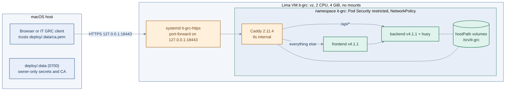

# Deployment

Phase 1 runs the unmodified intuitem CISO Assistant Community edition v4.1.1 as the GRC system of record in a dedicated Lima VM named `it-grc`. The official Helm chart installs it on k3s. `scripts/grc_lab.py` owns the whole lifecycle; the shared `security-lab` VM is not used. IT GRC talks to CISO Assistant (AGPL-3.0-or-later) only over HTTPS. See [ADR 0001](adr/0001-ciso-assistant-system-of-record.md).

## Architecture



| Component | Role |
|---|---|
| `deploy/lima/it-grc.yaml` | VM profile: pinned Debian image, provisioning of pinned k3s and Helm, the single port forward and the forward unit |
| `deploy/helm/values.yaml` | Non-secret chart values: domain, image digests, security contexts, resources, superuser env from a Secret |
| `deploy/upstream.json` | Every pin with its source; `grc_lab.py up` re-verifies them before use |
| `scripts/grc_lab.py` | `up`, `status`, `bootstrap-admin`, `verify`, `down`, `stop`, `destroy` |

## Pins

All pins were verified on 2026-10-13. `make grc-up` checks them again against the registries and release checksum files before it changes anything.

| Item | Version | Pin | Checked against |
|---|---|---|---|
| Lima base image | Debian 13 genericcloud 20261001-2618 | sha512 per architecture | Debian `SHA512SUMS` |
| k3s | v1.37.1+k3s1 | sha256 per architecture, checked in the guest | release `sha256sum-<arch>.txt` |
| Helm | v4.3.0 | sha256 per architecture, checked in the guest | `get.helm.sh` `.sha256sum` |
| Chart `oci://ghcr.io/intuitem/helm-charts/ce/ciso-assistant` | 0.13.3 | manifest `sha256:b25177e4ce80...`, content `sha256:15275730977a...` | ghcr.io manifest by tag and by digest, blob hash |
| Backend `ghcr.io/intuitem/ciso-assistant-community/backend` | v4.1.1 | `sha256:15f31d4eacd3...` | ghcr.io index digest by tag and body hash |
| Frontend `ghcr.io/intuitem/ciso-assistant-community/frontend` | v4.1.1 | `sha256:4a0bd757b9eb...` | ghcr.io index digest by tag and body hash |
| TLS proxy `docker.io/library/caddy` | 2.11.4 | `sha256:0c994536bddb...` | Docker Hub index digest by tag and body hash |

Full digests are in `deploy/upstream.json`. Unit tests fail if the VM profile or the Helm values carry a digest or checksum that is not in that file.

## Resources

Measured on 2026-10-13 on a fresh VM after the administrator bootstrap and repeated API reads.

| Measure | Value |
|---|---|
| Guest memory | 2.3 GiB used of 3.8 GiB, 1.6 GiB available; 4 GiB is sufficient |
| backend | 596 MiB (peak 692 MiB), limit 1536 MiB |
| huey | 272 MiB, limit 768 MiB |
| frontend | 427 MiB (peak 473 MiB), limit 768 MiB, V8 heap capped at 512 MiB |
| Caddy | 16 MiB, limit 128 MiB |
| Guest disk | 6.9 GB used of 20 GB; container images 5.4 GB; application data 157 MB |
| Host disk | 7.3 GB for the sparse VM disk |
| `make grc-up` | 6.5 min on a fresh VM with the Lima image cached; under 1 min when already installed |
| `make grc-admin` | about 1 min, one backend restart |

The image sets a 10 GiB V8 heap ceiling for the frontend. The values cap it at 512 MiB so garbage collection runs before the container limit is reached.

## Security controls

| Area | Control |
|---|---|
| VM boundary | Dedicated `it-grc` VM; no host mounts, no SSH agent forwarding, no host SSH keys, host proxy variables not propagated |
| Exposure | One forward: host `127.0.0.1:18443` to guest `127.0.0.1:18443`. Every other guest port is ignored, including the k3s API. No kubeconfig leaves the VM |
| Ownership | The script refuses a VM unless name, `owner` param, mounts, SSH flags and port forwards match. Namespace, volumes, Secrets and probe pods must carry its ownership label |
| Supply chain | Image, binaries, chart and container images pinned by digest; pins re-verified on every `up`; chart digest checked again inside the guest |
| TLS | Caddy internal CA; root exported to `deploy/.data/ca.pem`; strict SNI and Host matching answers 421 to other hosts |
| Host header | Django `ALLOWED_HOSTS` answers 400 to a disallowed Host inside the cluster |
| Network | Namespace-wide NetworkPolicy: ingress only from pods in `it-grc`, egress only to those pods and cluster DNS. The port-forward enters the TLS pod directly |
| Pods | Pod Security `restricted` enforced; non-root, read-only root filesystem, all capabilities dropped, `RuntimeDefault` seccomp, no service account tokens. Caddy keeps `NET_BIND_SERVICE` only in the bounding set because its binary carries a file capability |
| Secrets | Generated by the script, stored in 0600 files under the git-ignored `deploy/.data/`, sent to `kubectl create secret` on stdin only. Never in values, `--set`, command lines or output. The OIDC signing key is generated inside the VM and never reaches the host. k3s encrypts Secrets at rest |
| Data | SQLite, attachments and the Caddy CA on hostPath volumes with `Retain`; they survive `down` and `up` |

`make grc-verify` checks the release version, an authenticated API call, both Host header rejections, the NetworkPolicy from a pod in `default` and the absence of service account tokens. It never prints the password or token.

## Start and stop

```sh
make grc-up                    # create or start the VM, install or upgrade, wait for HTTPS
make grc-admin                 # create the administrator, or re-check its login
make grc-admin-secret          # copy deploy/.data/admin-password into the bootstrap Secret
make grc-verify                # live checks listed above
make grc-status                # VM, release, pods, memory, disk, HTTPS state
make grc-stop                  # stop the VM; CISO Assistant stays installed
make grc-down                  # uninstall the release and namespace; VM data is kept
make grc-destroy CONFIRM=yes   # delete the VM and all its data
```

`make grc-up` after `make grc-stop` starts the VM again and waits for HTTPS. Files under `deploy/.data/` survive `destroy`, so a rebuilt VM reuses the same Django key and administrator password.

## Log in

1. Open `https://localhost:18443`.
2. Email: `admin@example.org`.
3. Password: the owner-only file `deploy/.data/admin-password`. Copy it without printing it, for example `pbcopy < deploy/.data/admin-password` on macOS, paste it into the form, then clear the clipboard.

The browser does not trust the internal CA by default. Import `deploy/.data/ca.pem` into the browser profile, or compare its fingerprint before accepting the warning:

```sh
openssl x509 -in deploy/.data/ca.pem -noout -fingerprint -sha256
```

Host clients use the same file: `curl --cacert deploy/.data/ca.pem https://localhost:18443/api/health/`, or `ssl.create_default_context(cafile="deploy/.data/ca.pem")` in Python.

## Limits

- One node, one replica and SQLite. No high availability and no automated backup yet; `destroy` deletes the database.
- The upstream startup script reads the administrator password from the backend environment. It stays in the Secret `it-grc-bootstrap` and in that container environment. Changing the password in the UI does not update the local file; use `make grc-rotate-admin`, which updates the file and the Secret (see [Bridge](bridge.md)).
- Community edition limits from ADR 0001 apply: no service accounts and no custom roles.
- Egress is limited to the namespace and DNS. Mail is not configured, and features that need the internet do not work.
- The chart has no probes. `up` waits on `/api/health/` and `/login` over HTTPS instead.
- The port-forward reconnects within about 15 seconds after the TLS pod restarts.
- The Lima host agent also listens on host loopback for its own SSH proxy and DNS resolver. These are not application forwards.
- `verify` briefly runs a labeled probe pod in `default` and deletes it.
