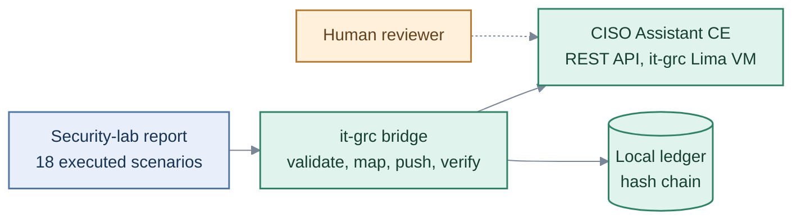
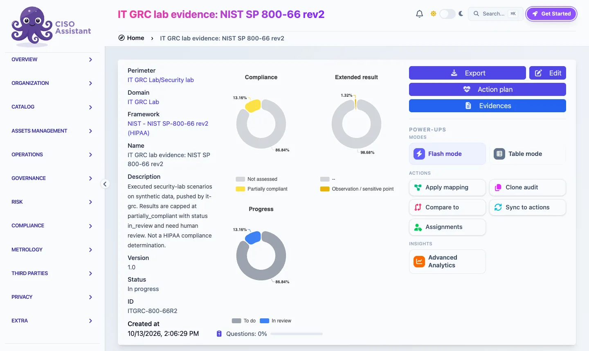

Security lab evidence / GRC system of record

# Put executed lab evidence where reviewers look.

IT GRC pushes executed security-lab scenarios into CISO Assistant Community edition as evidence revisions and capped requirement results, then verifies them against a local hash-chained ledger.

## How it works

- The lab report passes a strict validator, then a versioned mapping turns 18 scenarios into partial evidence for 20 NIST SP 800-66 rev2 requirement nodes and lists 97 requirements as `not_verified`.
- The bridge creates or updates the audit, 9 evidence objects with hashed revisions, one applied control and the mapped requirement assessments, capped at `partially_compliant` and `in_review`.
- Every push lands in a local ledger. `it-grc verify` compares CISO Assistant with it and reports drift; human decisions are listed as `HELD`.

[Run the demo](demo.md){ .overview-link }
[Read the article](article.md){ .overview-link }
[Deployment](deployment.md){ .overview-link }
[Mapping and push](mapping.md){ .overview-link }
[ADR 0001](adr/0001-ciso-assistant-system-of-record.md){ .overview-link }

!!! note "Scope"
    Executed lab scenarios on synthetic data. Lab evidence is not HIPAA compliance, and NIST SP 800-66 rev2 is guidance, not the rule. `compliant`, `done` and evidence approval stay human decisions in CISO Assistant. IT GRC is Apache-2.0; CISO Assistant CE is AGPL-3.0-or-later and runs unmodified as an external service.
